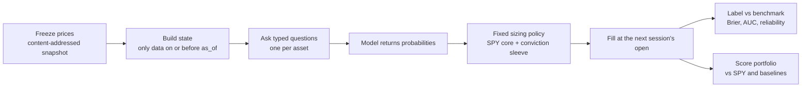

<div align="center">

# BeatSPY

**Decision models, not chat models.**

Four decision models read one frozen point-in-time market state, answer the same
typed probability questions, and are scored twice: were the probabilities
calibrated, and did the portfolio they built beat SPY?

[Live dashboard](https://beatspy.vercel.app) · [Architecture](ARCHITECTURE.md) · [Roadmap](ROADMAP.md) · [Contributing](CONTRIBUTING.md)

[](https://github.com/kingabzpro/beatspy/actions/workflows/ci.yml)
[](pyproject.toml)
[](LICENSE)
[](#the-models)

</div>

> [!IMPORTANT]
> **The honest result.** No model's active sleeve beat SPY in the published window,
> and no model's probabilities show measurable skill: every Brier skill is negative
> and every AUC permutation p-value is far from significant. The portfolio tracks
> SPY because it holds the index as its core, not because of forecasting.

## Latest benchmark

Rolling six months to the latest completed session (`2026-6m`), weekly decisions,
25 stocks and ETFs, one probability question per asset per week, 625 predictions
per model. Frozen adjusted prices throughout. Window 2026-04-09 to 2026-10-09;
every run holds an 85% SPY core and a 15% active sleeve, so "vs SPY" is the
sleeve's contribution, not an asset-allocation difference.

| Decision model | Return | vs SPY | Excess 95% CI | Sharpe | Max DD | Turnover | Brier skill | AUC |
| --- | --- | --- | --- | --- | --- | --- | --- | --- |
| `clef-flash` | **+14.06%** | −1.03% | [−3.23%, +0.67%] | 2.37 | −3.95% | 5.0% | −0.293 | 0.498 |
| `clef` | +13.95% | −1.14% | [−3.71%, +0.75%] | 2.37 | −3.87% | 5.2% | −0.242 | 0.501 |
| `gpt-6-luna` | +13.76% | −1.33% | [−3.83%, +0.56%] | 2.34 | −3.94% | 4.4% | −0.023 | 0.471 |
| `jev-latest` | +13.69% | −1.40% | [−3.65%, +0.32%] | 2.32 | −3.93% | 5.2% | −0.085 | 0.481 |
| *SPY buy-and-hold* | *+15.09%* | n/a | n/a | n/a | n/a | n/a | n/a | n/a |

Every excess interval includes zero, so at 25 decisions none of the four
differences is distinguishable from noise. Two providers stay underconfident:
`clef` and `clef-flash` answered a mean 0.30 where the realized rate was 0.45.

<details>
<summary><b>Why the numbers moved from −11 points behind SPY to −1</b></summary>

The policy history is the same story told three times. The earliest cut held only
the top three names above 0.5, rewrote the whole book weekly at ~50% turnover, and
returned −9.3% to +0.7%. Graded sizing over the whole book roughly halved
turnover and added 8 to 17 points. The SPY core removed the remaining structural
gap: the same model over the same window returned +7.77% (23.3% turnover, −7.33
points behind SPY) with the whole-book policy and +13.69% (5.2% turnover, −1.40)
with an 85% core. Every one of those gains is portfolio construction, not
forecasting; the calibration columns are unchanged by them.

</details>

## The models

| Model | Provider | Endpoint | Input price |
| --- | --- | --- | --- |
| `gpt-6-luna` | OpenAI [Decisions API](https://developers.openai.com/api/docs/guides/decisions) (public beta) | `api.openai.com/v1/decisions` | $0.10 / 1M |
| `jev-latest` | [TypeSafe Jev](https://docs.typesafe.ai/api-reference) | `api.typesafe.ai/v1/systemone` | $0.042 / 1M |
| `clef` | Cloudflare [Clef](https://developers.cloudflare.com/workers-ai/models/clef/) (27B) | Workers AI | $0.24 / 1M |
| `clef-flash` | Cloudflare Clef-flash (9B) | Workers AI | $0.09 / 1M |

All four bill **input tokens only**: output is free because there is no output
text, and none offers prompt caching (pricing checked 2026-10-08). One run asks
one question per asset and one call answers them all, so a complete 25-week
benchmark of all four models costs about **$0.07**.

## Quick start

```bash
git clone https://github.com/kingabzpro/beatspy.git
cd beatspy
uv sync --extra dev
uv run beatspy setup                 # pick a model and store its key
uv run beatspy run --model clef-flash --scenario 2026-6m
uv run beatspy report --open         # render the dashboard locally
```

No keys yet? `uv run beatspy demo` builds synthetic runs and renders the same
dashboard offline. `uv run beatspy models` shows which credentials resolve, and
`uv run beatspy doctor --probe` makes one live call per model.

## How it works



<details>
<summary><b>One decision, step by step</b></summary>

1. The scenario resolves its dates and loads a content-addressed snapshot, or
   freezes a new one; a 15-minute buffer keeps unfinished sessions out.
2. The state is built from data dated on or before the decision date only, and
   kept inside a token budget that is enforced, not assumed.
3. The model returns one typed answer per question: `noul` (a yes/no
   probability), `choice`, or `score`. Refusals and missing answers are recorded
   as missing coverage, never invented.
4. The fixed policy turns the probabilities into target weights. The model never
   states an allocation.
5. Orders fill at the next session's open. Every probability is then labeled by
   whether that asset actually beat the benchmark over the same horizon.

</details>

<details>
<summary><b>How probabilities become a portfolio</b></summary>

The default policy is **core_satellite**: `core_weight` of the book (85%) holds
the benchmark itself, exempt from the position limit because the index is not a
single-name bet. The remaining sleeve spreads across the universe, half evenly
and half by each probability's distance above the decision's own mean, so the
same ranking produces the same weights under any scale a provider answers on.
`--core-weight 0.95` makes the book almost a tracker.

Three earlier policies stay selectable so recorded runs remain reproducible:
`graded_cs` (the same rule over the whole book, no core), `graded` (conviction
above a fixed 0.5 prior), and `top_n` (the earliest top-three cut). Under every
graded policy an unanswered question carries no conviction share, so a provider
failure can never become a directional bet.

</details>

<details>
<summary><b>How it is scored</b></summary>

**Calibration.** Each probability is labeled by whether the asset beat the
benchmark over the horizon, a relative outcome, so a rising market cannot mark
every prediction correct. Per form: Brier, Brier skill against a constant at the
sample rate, log loss, tie-aware AUC, accuracy, and 10-bin reliability with
expected and maximum calibration error. `miscalibration_gap` compares the noul
and choice forms on the same question and is reported only when a run asks both
(`--form twin` or `all`).

**P&L.** The portfolio runs through the same accounting engine, on the same
frozen prices, against SPY buy-and-hold and three deterministic references:
equal weight, 60/40, and 12-minus-1 momentum. Sharpe uses a zero risk-free rate
(`risk_free_annual = 0.0`), recorded per run.

**Uncertainty.** Samples are clustered by decision date, so a run's effective
sample is closer to its number of decisions than to its number of predictions.
`metrics.json` carries a 95% block-bootstrap interval for the return and for the
paired excess over SPY, and a two-sided permutation p-value for each signal's
Brier skill and AUC, with outcomes shuffled within decision dates. Both are
seeded, so replay reproduces them exactly.

</details>

<details>
<summary><b>What one window can prove</b></summary>

`examples/power_analysis.py` simulates the benchmark's own tests. For a book with
about 1% daily volatility, the share of runs whose 95% interval excludes a true
excess of a given size:

| Decision windows | 2%/yr | 5%/yr | 10%/yr | 20%/yr |
| --- | --- | --- | --- | --- |
| 25 (the published run) | 6% | 6% | 7% | 14% |
| 50 | 5% | 6% | 10% | 26% |
| 100 | 4% | 6% | 14% | 44% |
| 250 | 5% | 8% | 28% | 79% |

A six-month, 25-decision benchmark cannot separate a 20%/year edge from luck;
roughly 250 weekly windows are needed for 80% power at that effect size. The
table describes the sample, it does not test the model.

For calibration at the observed probability spread (sd about 0.05), the two
p-values behave very differently, which is why every signal reports both. A
perfectly calibrated informative model (AUC 0.55) is rejected by the Brier-skill
test only 3% of the time even at 100 windows, because the Brier score is
dominated by its calibration term near 0.5; the AUC test finds the same model 68%
of the time at 25 windows. In short: read `auc_p_value` when probabilities sit
near 0.5. And Brier alone cannot say which way a model is wrong: it is invariant
under flipping both the probability and the outcome distribution, so reliability
bins and accuracy are what separate "confidently wrong" from "hedging".

</details>

<details>
<summary><b>Trust: replay, no look-ahead, no credentials in the dashboard</b></summary>

- `beatspy verify` replays a finished run offline: artifact hashes, the snapshot
  manifest, the decision schedule, and the recorded weights through the
  accounting engine, and requires exact agreement with the stored metrics.
- `examples/leakage_audit.py` is an adversarial check: it tampers with every
  price after a run's midpoint and requires every earlier decision to be
  byte-identical while later ones change. On the published runs, 12 of 12
  pre-cut decisions were identical and 13 of 13 post-cut decisions changed.
- Prices are frozen into content-addressed snapshots; the state contains only
  data dated on or before the decision date, and the token budget is enforced
  before the state is sent.
- The dashboard contains no credentials and reads reviewed JSON artifacts only.

</details>

<details>
<summary><b>Commands</b></summary>

```bash
uv run beatspy run --model clef-flash clef jev-latest gpt-6-luna --scenario 2026-6m
uv run beatspy run --model gpt-6-luna --max-decisions 12
uv run beatspy run --model clef --form all        # ask every question form
uv run beatspy run --max-cost-usd 0.05            # abort a run that would overspend
uv run beatspy state --scenario 2026-6m           # what a decision would read, and its token cost
uv run beatspy calibrate <run-id>                 # calibration table for one run
uv run beatspy verify results/<run-id>            # offline replay of a finished run
uv run beatspy compare                            # latest run per decision model
```

</details>

<details>
<summary><b>Requirements and credentials</b></summary>

- Python 3.11+ and [uv](https://docs.astral.sh/uv/). Dependencies: pydantic,
  pandas, numpy, httpx, exchange-calendars, yfinance.
- A key for whichever model you run. TypeSafe needs `TYPESAFE_API_KEY`; OpenAI
  needs `OPENAI_API_KEY`; Cloudflare needs `CLOUDFLARE_ACCOUNT_ID` plus
  `CLOUDFLARE_AUTH_TOKEN`. Each also has a `BEATSPY_`-prefixed form that wins.
- Keys come from the environment, a project `.env`, or `~/.beatspy/secrets.env`.
  `.env` is git-ignored and never imported by the dashboard.
- Everything is HTTP-based, so the Clef path works through the Workers AI REST
  endpoint with no Worker or TypeScript build step.

</details>

<details>
<summary><b>Development</b></summary>

```bash
uv sync --extra dev
uv run --no-sync pytest              # 270+ tests, no network and no credentials
uv run --no-sync ruff check .
node --test tests/dashboard.test.cjs
uv run python examples/leakage_audit.py   # adversarial look-ahead audit on a finished run
```

The suite is hermetic: a scripted offline client answers every question form, so
complete runs are executed, scored, replayed, rendered, and audited inside the
tests.

</details>

## License

Apache-2.0. See [LICENSE](LICENSE).
